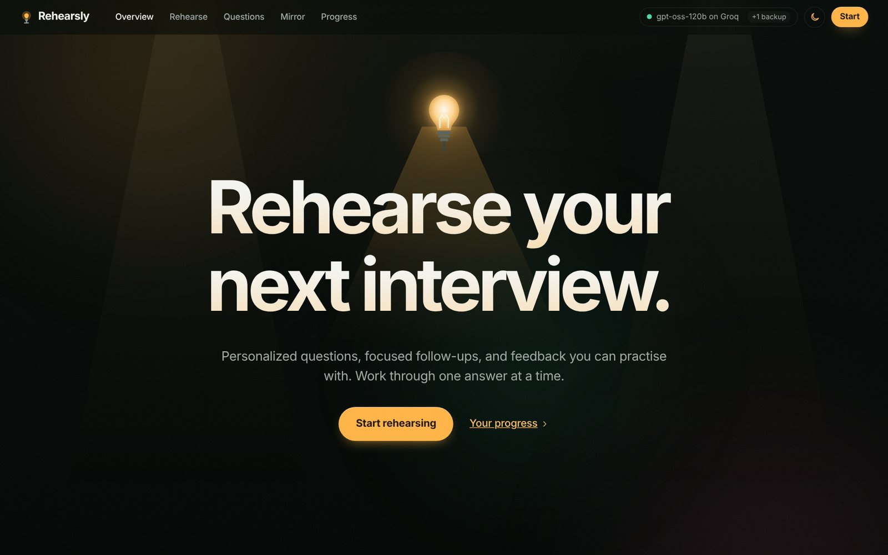
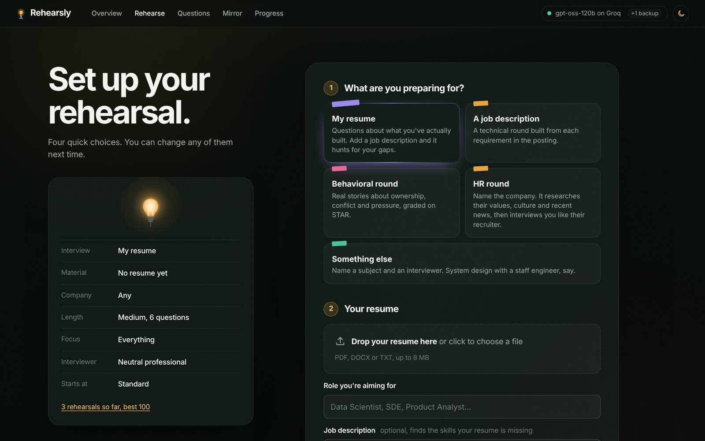
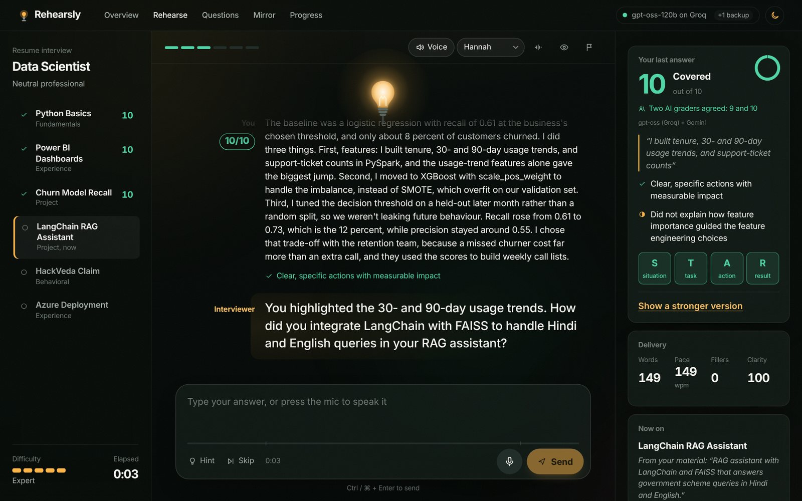
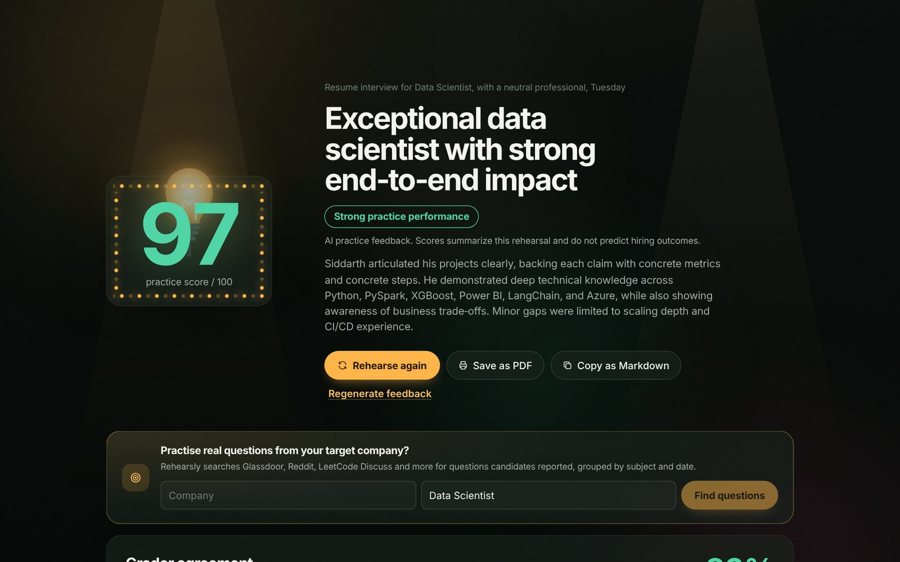
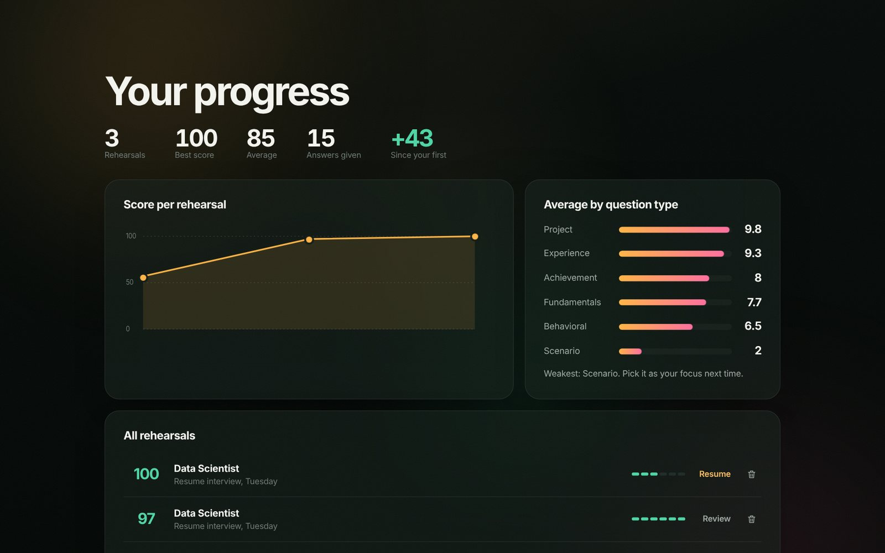
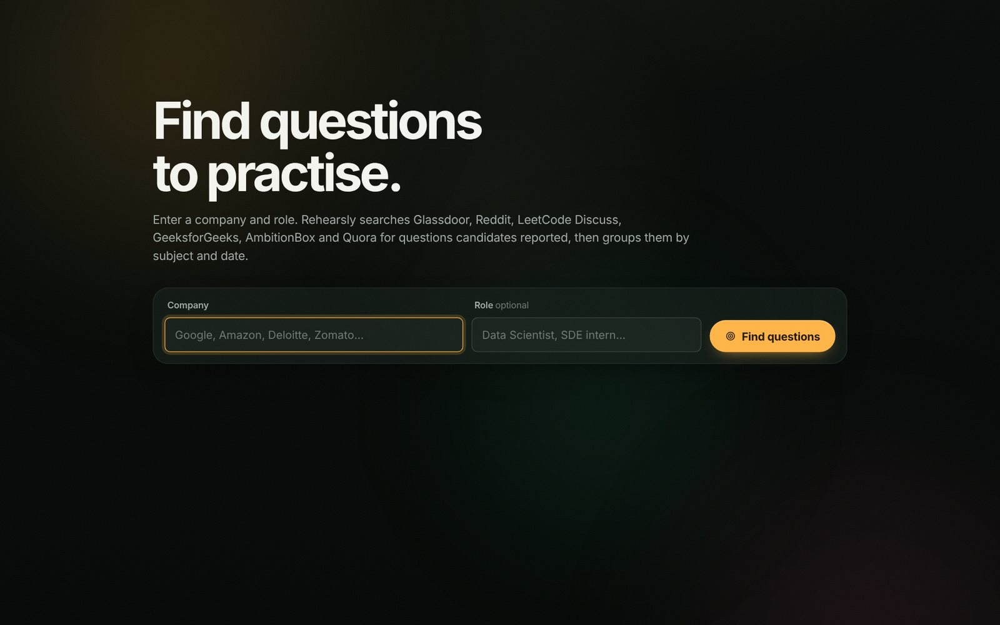
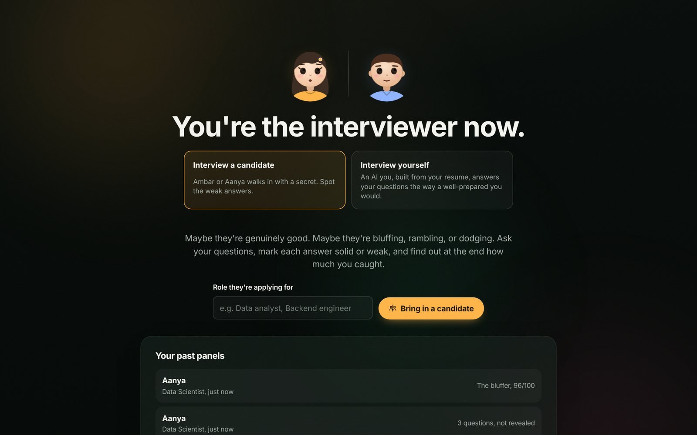
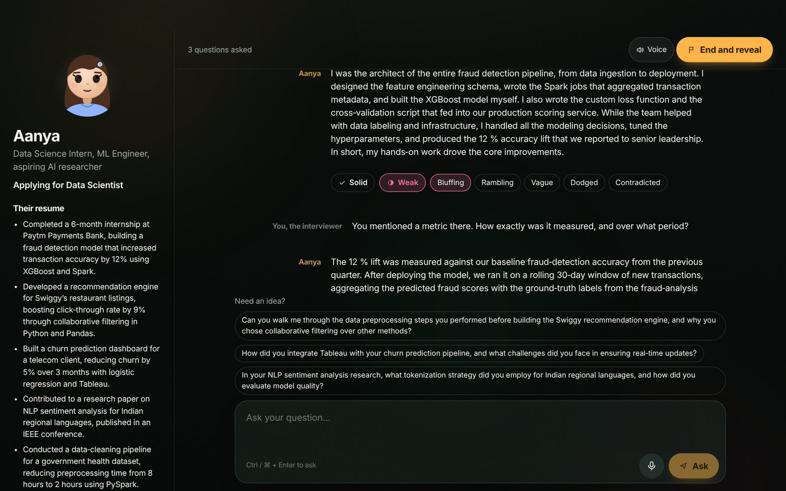
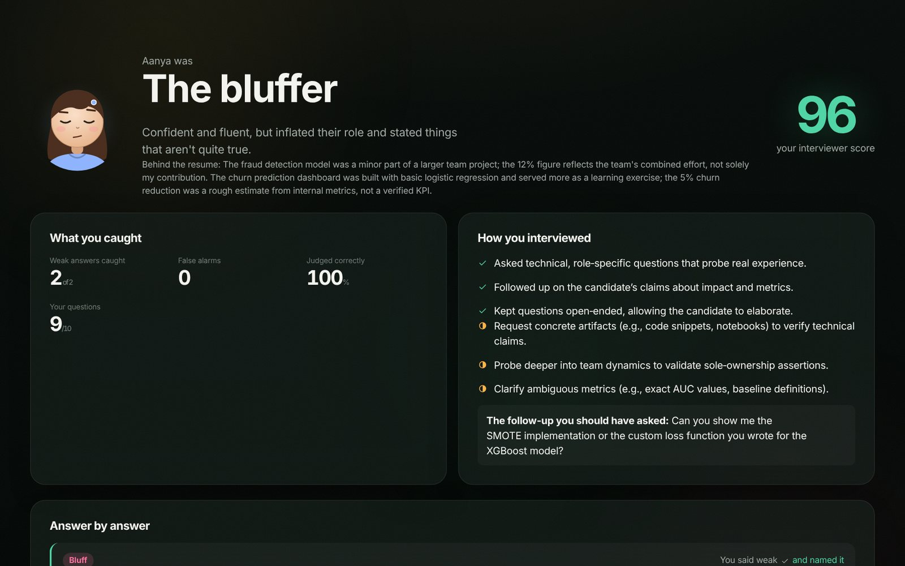
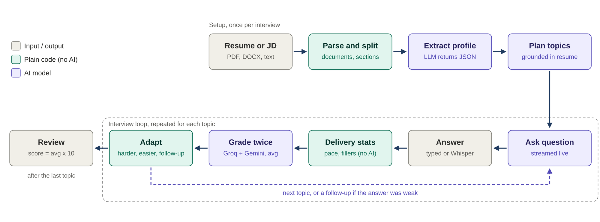

<div align="center">

# Rehearsly

**An AI interviewer that actually read your resume.**

It asks about your real projects, pushes back when an answer is thin, gets harder as you get better,<br>
and grades every answer with two independent AI judges. Then it flips the table.

### [Try it live: rehearsly-five.vercel.app](https://rehearsly-five.vercel.app)

[Features](#features) &nbsp;|&nbsp; [Mirror mode](#mirror-mode-you-are-the-interviewer) &nbsp;|&nbsp; [How it works](#how-it-works) &nbsp;|&nbsp; [Tech stack](#tech-stack) &nbsp;|&nbsp; [Results](#results) &nbsp;|&nbsp; [Run locally](#run-locally)

<br>



</div>

<br>

## Why Rehearsly

Ask a general chatbot to interview you and it asks textbook questions, praises everything, and sometimes invents things you never did. Rehearsly puts structure around the model:

- **Grounded questions.** Every topic must quote a real line from your resume, and the server checks it before asking.
- **Honest grading.** A fixed rubric, two graders from different model families, and a score you can verify by hand.
- **A real conversation.** Follow-ups on weak answers, adaptive difficulty, and spoken answers with voice playback.

<br>

## Features

<table>
  <tr>
    <td width="50%" valign="top">
      <br>
      <b>Five interview types</b><br>
      Resume, job description, behavioural (STAR), HR round for a named company, or any custom subject. Pick length, focus areas, interviewer style and starting difficulty.
    </td>
    <td width="50%" valign="top">
      <br>
      <b>The interview room</b><br>
      One question at a time, streamed live. Type or speak (Whisper), with hands-free mode. Live grade, quoted evidence, what was missing, STAR coverage and delivery stats after every answer.
    </td>
  </tr>
  <tr>
    <td width="50%" valign="top">
      <br>
      <b>A review you can act on</b><br>
      Practice score, strengths, gaps, a three-step plan, a stronger version of every answer, and a one-click drill on only your weak topics. Export as PDF or Markdown.
    </td>
    <td width="50%" valign="top">
      <br>
      <b>Progress over time</b><br>
      Score trend, averages by question type and full history, stored privately in your own browser.
    </td>
  </tr>
  <tr>
    <td width="50%" valign="top">
      <br>
      <b>Company question bank</b><br>
      Enter a company and role. Live web search across Glassdoor, Reddit, LeetCode Discuss, GeeksforGeeks and more, grouped by subject and round with source links.
    </td>
    <td width="50%" valign="top">
      <br>
      <b>Mirror mode</b><br>
      Switch sides and interview an AI candidate with a hidden persona. Spot the bluffs, the rambling and the dodges. More below.
    </td>
  </tr>
</table>

<br>

## Mirror mode: you are the interviewer

Most interview tools only put you in the candidate's chair. Mirror mode swaps the roles. You question Aanya or Ambar, an AI candidate with a resume and a secret: they might be genuinely strong, or a bluffer, a rambler, or someone who never gets specific. Mark each answer solid or weak, name the flaw, and find out at the reveal how much you caught.

Sitting on the other side teaches what interviewers listen for, and you start hearing the same problems in your own answers.

<table>
  <tr>
    <td width="50%"></td>
    <td width="50%"></td>
  </tr>
  <tr>
    <td valign="top">Judge every answer and tag the flaw: bluffing, rambling, vague, dodged or contradicted.</td>
    <td valign="top">The reveal: who they really were, what you caught, false alarms, and the follow-up you should have asked.</td>
  </tr>
</table>

| Persona | How they answer |
|---|---|
| The genuine article | solid 85%, vague 15% |
| The bluffer | solid 40%, bluff 45%, contradiction 15% |
| The rambler | solid 45%, ramble 45%, dodge 10% |
| The generalist | solid 40%, vague 50%, dodge 10% |
| The mixed bag | solid 45%, bluff 15%, ramble 15%, vague 15%, dodge 10% |

The hosted app has no database, so the persona travels with the browser inside a sealed token: XOR with a SHA-256 keystream and signed with HMAC. The browser carries it but cannot read or change it. There is also an **Interview yourself** option, where the AI answers as a well-prepared version of you, built from your own resume.

<br>

## How it works



**Setup, once per interview**
1. **Read** the resume with `pypdf` or `python-docx`, clean it, and split it into sections.
2. **Extract** a structured profile (roles, projects, skills, numbers) as JSON with gpt-oss-120b.
3. **Plan and ground** topics. Each one must quote a resume line, and code verifies it exists. If not, it is relinked to the closest real line or dropped.

**The loop, once per topic**

4. **Ask.** gpt-oss-20b writes the question from the topic, the retrieved resume passage (RAG) and everything already asked, streamed over SSE.
5. **Answer.** Typed, or spoken and transcribed by Whisper.
6. **Measure delivery** with plain code: words, pace, filler words, numbers mentioned.
7. **Grade twice in parallel.** gpt-oss-20b on Groq and Gemini score against the same rubric without seeing each other. The grade is the average.
8. **Adapt.** 8 or more raises difficulty, 4 or less lowers it, and a thin answer gets a targeted follow-up.

**The end**

9. **Review.** Practice score = average grade x 10, calculated by code, not the model. The AI writes the feedback and practice plan.

**Reliability.** Every AI call goes through one client with a fallback chain (Groq model, other Groq model, Gemini), short cooldowns after rate limits, an 8-second cap on the second grader, and a plain-code fallback for every AI step.

<br>

## Tech stack

| Layer | Technology | Why |
|---|---|---|
| Frontend | React, TypeScript, Vite | Component-based UI, type safety, fast builds |
| Backend | Python, FastAPI | Python AI ecosystem, request validation, streaming |
| Main model | gpt-oss-120b / gpt-oss-20b on Groq | Strong reasoning, very low latency for live conversation |
| Second grader | Google Gemini | Independent judge from another model family, and a fallback |
| Speech | Whisper large-v3-turbo, Orpheus TTS | Accurate transcription, natural interviewer voice |
| Live text | Server-Sent Events | Word-by-word streaming that works on serverless |
| Retrieval | BM25 (hosted), Ollama embeddings + FAISS (local) | Sends only the relevant resume passage to the model |
| Web search | Groq browser search | Live, current questions for the question bank |
| Documents | pypdf, python-docx | Lightweight resume parsing that runs on serverless |
| Hosting | Vercel | Free HTTPS deployment for the site and the API |
| Storage | Browser localStorage (hosted), SQLite (local) | No user data kept on the server |

<br>

## Results

| Check | Result |
|---|---|
| Strong vs weak interview on the same resume | **97** vs **57** practice score |
| Grader ranking on 24 answers of known quality | Spearman **0.92** (before fix), **0.91** (after) |
| Confident but wrong SQL answer | Scored **6** under the original rubric, **3** after adding a correctness rule |
| Agreement between Groq and Gemini | Weighted kappa about **0.8** |
| Grading time per answer | about **1.7 s** (down from 21.8 s after capping the second grader) |
| Mirror mode, bluffer persona | **2 of 2** bluffs caught, interviewer score **96** |
| Automated tests | **7 of 7** passing |

The grader benchmark lives on the in-app Study page (`#/study`): 24 fixed answers, automatic checks, and blind human rating.

<br>

## Project structure

```
server/
  main.py         API routes, uploads, rate limiting, SSE
  engine.py       planning, grounding, questions, grading, adaptation, review, drills
  llm.py          Groq / Gemini / Ollama client, JSON output, streaming, fallback, speech, search
  prompts.py      interviewer styles, difficulty levels, rubric, JSON schemas
  analytics.py    delivery statistics without AI
  documents.py    PDF / DOCX / TXT text extraction
  sections.py     resume section detection
  retrieval.py    BM25 and FAISS hybrid retrieval
  research.py     company question bank
  mirror.py       Mirror mode personas, sealed tokens, reveal scoring
  study.py        grader benchmark
  store.py        SQLite or browser storage
web/src/
  pages/          Overview, Setup, Room, Review, Questions, Mirror, Progress, Study
  components/     animated faces, charts, icons
  lib/            API client, voice, routing, storage
tests/            regression tests with simulated model responses
```

<br>

## Run locally

Requires Python 3.10+ and Node.js 18+.

**With Groq (same as the live site)**

```bash
python3 -m venv .venv && source .venv/bin/activate
pip install -r requirements.txt "uvicorn[standard]"
cd web && npm ci && npm run build && cd ..
export GROQ_API_KEY=your_key          # required
export GEMINI_API_KEY=your_key        # optional: second grader and fallback
python run.py
```

**Fully offline with Ollama**

```bash
ollama pull llama3.2
ollama pull nomic-embed-text
pip install -r requirements-local.txt
python run.py
```

Open http://127.0.0.1:8000. For frontend development, run `npm run dev` inside `web/`.

**Deploy to Vercel**

```bash
npx vercel env add GROQ_API_KEY
npx vercel --prod
```

`app.py` is the serverless entry point and the built frontend is served from `public/`.

**Tests**

```bash
python -m unittest discover -s tests -v
```

The tests use simulated model responses, so they run offline and use no API quota.

<br>

## Privacy

On the hosted site, interviews are stored only in your browser and sent with each request. Nothing is kept on the server. Resumes and answers are processed by Groq and Google. For fully private use, run it locally with Ollama.

## Roadmap

- Validate grades against several independent human raters
- Correct each model's grading bias before averaging
- Coding and system design rounds
- Hindi and other Indian languages for spoken answers

<br>

## Author

**Siddarth Valasubramanian**<br>
B.Tech CSE (Data Science), UPES Dehradun<br>
[LinkedIn](https://www.linkedin.com/in/siddarth-valasubramanian) &nbsp;|&nbsp; [GitHub](https://github.com/SiddarthValas)

## License

MIT. See [LICENSE](LICENSE).
